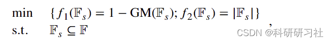
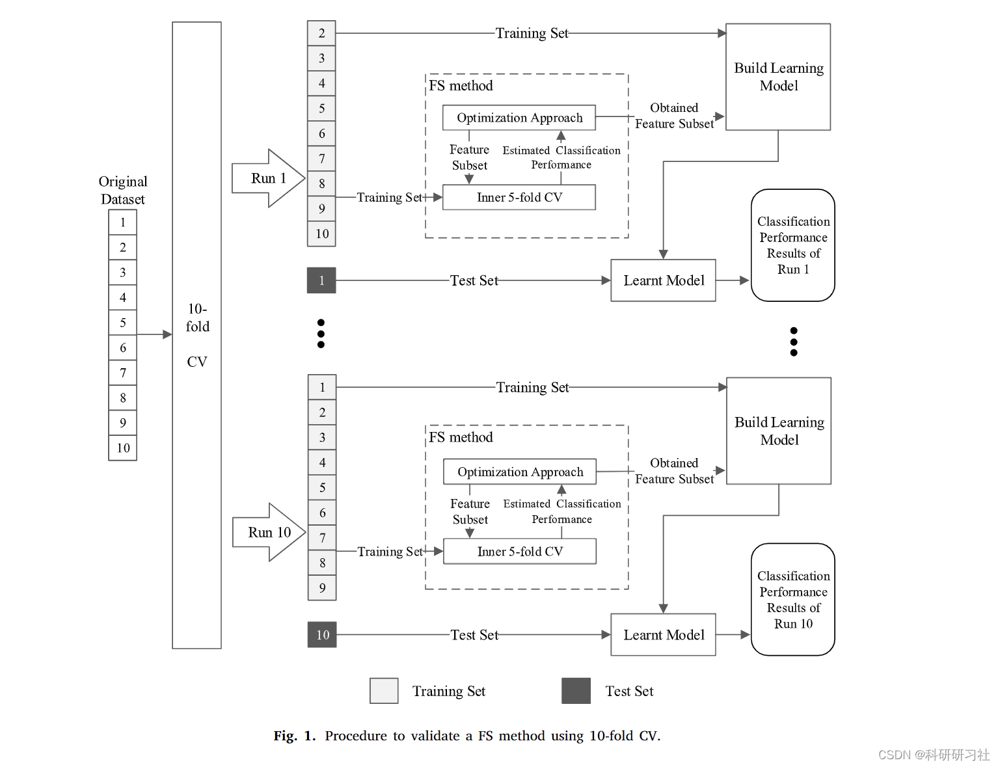
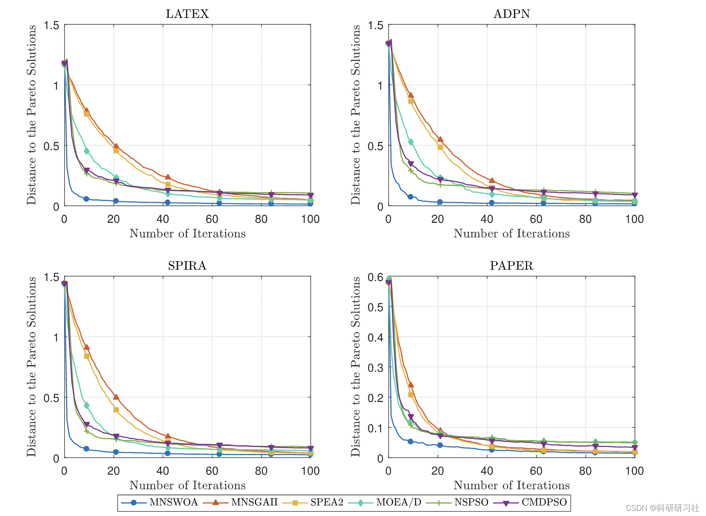
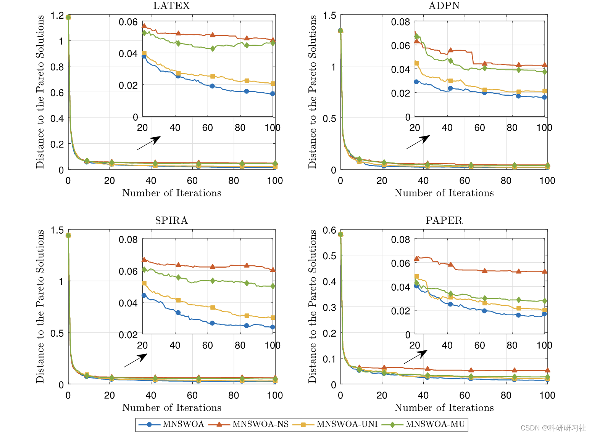

# Multi-objective feature selection for key quality characteristics identification in the production process using whale optimization algorithm based on non-dominated sorting

1. Overview of Modern Production Processes
The modern production process often involves a large number of quality characteristics (QC), including process parameters, assembly parameters, and part parameters (Lee & Thornton, 1996). In practice, not all QC can be perfectly designed or controlled at the early stages of product production. Therefore, selecting key quality control (KQC) that significantly impacts final product quality is an important task in continuous quality control and improvement (Peres & Fogliatto, 2018; Shang et al., 2014). With the rapid advancement of data collection technologies, high-dimensional production data collected from production lines are becoming more frequent in modern manufacturing, laying the foundation for data-driven KQC identification methods (Li et al., 2020a; Yang et al., 2019). However, the high dimensionality of data poses significant challenges to traditional statistical methods, such as variance analysis or multivariate linear regression methods.
Identifying key quality characteristics (QC) during the production process is crucial for product quality control and improvement. This paper introduces a feature selection (FS) method based on multi-objective packaging, which uses an improved non-dominated sorting whale optimization algorithm (MNSWOA) and ideal point method (IPM) to identify key QC (KQC) in imbalanced production data. In the proposed method, the FS problem is defined as maximizing the geometric mean (GM) metric and minimizing the size of the feature subset. To address the defined FS problem, first, MNSWOA is employed to find a set of candidate solutions (feature subsets), followed by IPM to select the final solution. An improved rapid non-dominated sorting method is introduced in MNSWOA to adapt the single-objective whale optimization algorithm to multi-objective scenarios. Additionally, a unified reference solution selection strategy and mutation operation are embedded in MNSWOA to enhance its search performance. Experimental results on four imbalanced production datasets demonstrate that the proposed FS method is effective and efficient for KQC identification. Further comparisons show that MNSWOA achieves better search performance than benchmark multi-objective optimization methods, including improved NSGA-II, SPEA2, MOEA/D, NSPSO, and CMDPSO2 mathematical models.
Detailed mathematical models are available in Part 5.
3. Process Flow Diagram Editor
4 Examples and Running Results
Editor
Editor
5 Matlab code and detailed article

## Images

<!-- PAYMENT_BLOCK -->

## Get this dataset

- Payment link (Stripe): [Buy now](https://buy.stripe.com/3cs8yP7sY87d0vu9AB)
- Payment QR code: 

<!-- /PAYMENT_BLOCK -->
